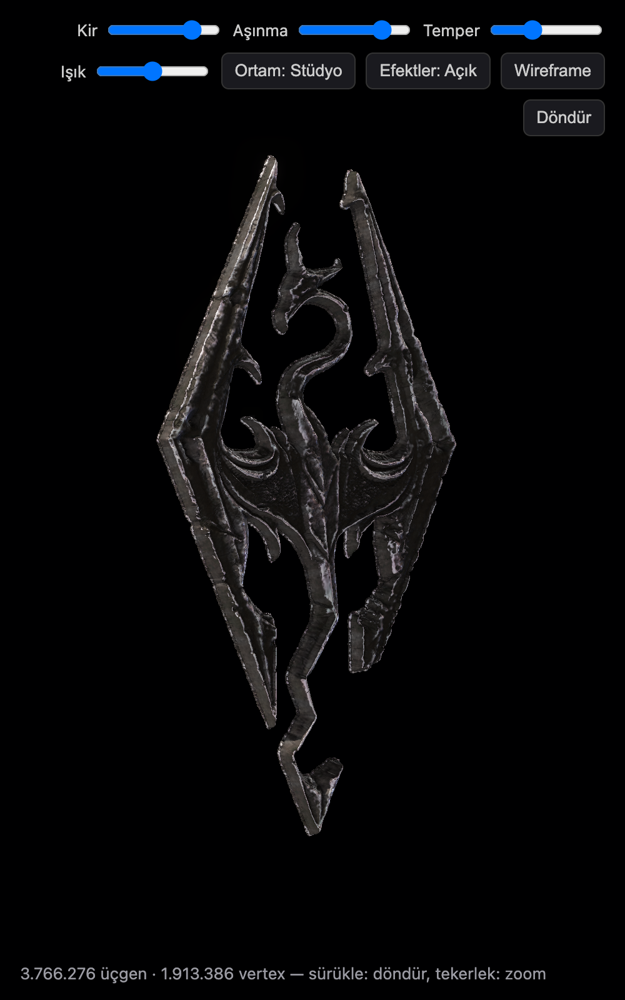

# Skyrim Emblem 3D

Tek bir 2D görselden prosedürel olarak üretilmiş, yüksek poligonlu (3,7M üçgen) ve yıpranmış demir
görünümlü 3D ejderha emblemi. Tarayıcıda gerçek zamanlı çalışır (three.js).

**Canlı demo:** https://skyrim-emblem-3d.vercel.app



## Ne var içinde

- `build_mesh.py`: `source.png`'den height field çıkarır; ön/arka/yan yüzlü mesh ile albedo,
  roughness, cavity, object-space normal ve curvature map'lerini üretir.
- `index.html`: three.js viewer. HDRI ortam (Poly Haven, CC0), curvature'a göre kenar parlaması ve
  oksitlenme, GTAO, bloom, 4096 shadow map, iridescence ile ısıl renk (temper).
- Arayüzde kir, aşınma, temper, ışık, ortam ve wireframe kontrolleri var.

## 3D dosya

GLB dosyaları [Releases](../../releases) sayfasında:
- `emblem.glb`: ham mesh (106 MB)
- `emblem.web.glb`: meshopt ile sıkıştırılmış hâli (16 MB, `EXT_meshopt_compression`)

Map'ler repo kökünde PNG olarak duruyor (R = albedo, G = roughness, B = cavity).

## Çalıştırma

```bash
python3 -m http.server 8000   # sonra http://localhost:8000
```

Yeniden üretmek için: `python3 build_mesh.py 4 8` (numpy, pillow, scipy gerekir).

## Not

Bu proje ticari olmayan bir fan art çalışmasıdır. The Elder Scrolls V: Skyrim ve ejderha emblemi
Bethesda Softworks / ZeniMax Media'nın tescilli markalarıdır; bu proje onlarla bağlantılı değildir.
HDRI'lar Poly Haven'dan (CC0).
